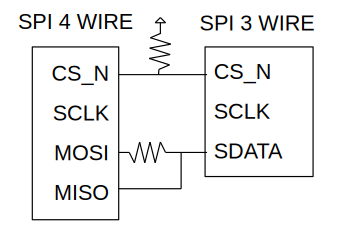
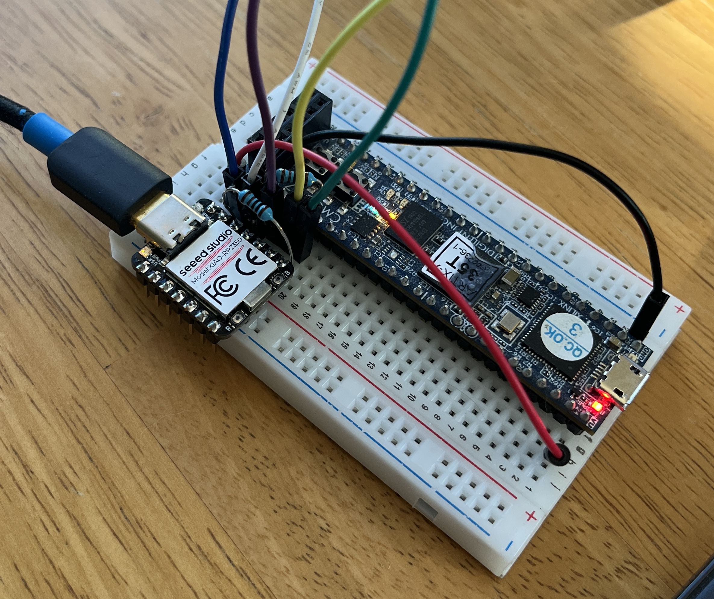

# 3_wire_spi_slave_open_drain_chip_select
Demonstration of 3 Wire SPI slave with an open drain chip select that allows interrupt notifications to the controller.

**"Just add 2 resistors!"**

By allowing the SPI chip select to be bidirectional, interrupt notifications can be done while when the CS wire is inactive-high. A low pulse on the CS wire indicates that the slave has an interrupt condition. I suspected that it would be trivial for a controller's CS pin (most times implemented as a simple GPIO pin) to be configured with an open drain and the rising edge triggers a callback routine. The included MicroPython code demonstrates this.

While an I2C bus with a single shared open drain interrupt allows for a very low pin-count system, a 3 wire SPI with a dedicated interrupt is a much higher performance alternative. The interrupt being shared with the chip select allows for the controller to immediately know which slave has the interrupt. The higher clock speed of the 3 wire SPI allows for at least a 10x faster data transfer.

I3C and SPMI are an excellent balance of low pin-count and fast data transfer, but good luck finding an MCU that supports either of them. The ubiquity and flexibility of SPI allows for 3 wire open drain chip select to be used in literally every MCU system.  

